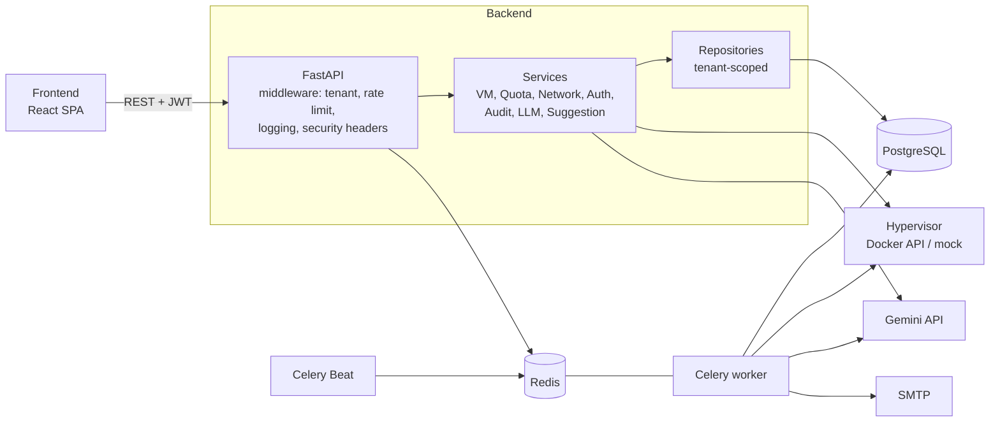

# CloudIaaS — Backend

Backend мультитенантной IaaS-платформы: тенанты получают изолированные пространства с квотами на ресурсы и управляют в них виртуальными машинами и виртуальными сетями через REST API. Гипервизор эмулируется Docker-контейнерами. Платформа умеет подбирать конфигурацию ВМ по текстовому описанию нагрузки с помощью LLM (Gemini) и периодически предлагать оптимизации по метрикам использования.

Стек: Python 3.13, FastAPI, SQLAlchemy 2 (async), PostgreSQL, Redis, Celery.

Клиентская часть: [enterpraizer/Frontend](https://github.com/enterpraizer/Frontend) (React + TypeScript).

## Возможности

- **Мультитенантность.** Идентификатор тенанта передаётся в JWT, middleware кладёт его в `request.state`, а базовый `TenantScopedRepository` добавляет фильтр по `tenant_id` во все запросы (get / list / count / create / update / delete). Изоляцию проверяют интеграционные тесты: чужие ВМ недоступны для просмотра и остановки, сети тоже изолированы.
- **Квоты.** На тенанта задаются лимиты по vCPU, RAM, диску и числу ВМ. Перед созданием ВМ ресурсы резервируются; при превышении API отвечает `429` с полями `resource`, `requested`, `available`. Остановка ВМ освобождает CPU и RAM (диск остаётся занятым), удаление освобождает всё. Если провижининг упал, запись ВМ откатывается, а квота возвращается.
- **Виртуальные машины.** Создание, список с пагинацией и фильтром по статусу, запуск, остановка, удаление, переименование. Статусы: `pending`, `running`, `stopped`, `terminated`. Недопустимые переходы возвращают `409`.
- **Виртуальные сети.** CRUD сетей с CIDR, проверка пересечения CIDR внутри тенанта (`409`), подключение и отключение ВМ.
- **Гипервизор.** `HypervisorService` запускает для каждой ВМ контейнер `alpine:latest` (`sleep infinity`) с лимитами CPU и памяти и отдельным Docker-томом под диск. Если Docker недоступен, сервис переходит в mock-режим и возвращает заглушки (`mock-…` идентификаторы, IP `10.0.0.1`). Размер диска на уровне тома не ограничивается — он учитывается только в квотах.
- **Аутентификация.** Регистрация с подтверждением почты (ссылка действует час), логин по OAuth2 password flow, пара access/refresh JWT с разными секретами, пароли хранятся как bcrypt-хэши, смена пароля. Роли `user` и `admin`. После регистрации пользователь создаёт рабочее пространство (`POST /auth/tenant`) и получает токены с `tenant_id`.
- **Rate limiting.** Redis-middleware со скользящим окном по IP: 100 запросов в минуту на весь API и 10 в минуту на `/auth/*`. При недоступности Redis запросы пропускаются.
- **Аудит.** Действия над ВМ и сетями пишутся в журнал (`vm.create`, `vm.start`, `vm.stop`, `vm.terminate`, `vm.resize`, `network.create`, `network.delete`). Тенант видит свою ленту активности, администратор — общий журнал с фильтрами по тенанту, действию и датам.
- **Админ-API.** Управление тенантами и их квотами, общая статистика, список ВМ всех тенантов.
- **Фоновые задачи (Celery + Celery Beat).** Отправка писем, синхронизация статусов ВМ с Docker, очистка старых удалённых ВМ, сбор метрик, AI-анализ, еженедельный дайджест. Подробнее ниже.
- **Прочее.** Security-заголовки, CORS, логирование запросов с временем выполнения, `/health` с проверкой БД, кэш сводки по квотам в Redis на 30 секунд, миграции Alembic.

## AI-рекомендации

### Подбор конфигурации по описанию

`POST /vms/suggest` принимает свободное описание нагрузки (10–1000 символов) и возвращает `vcpu`, `ram_mb`, `disk_gb`, `reasoning` (на русском) и `confidence`.

- **Модель:** `gemini-flash-lite-latest` через SDK `google-genai` (значение по умолчанию, меняется переменной `LLM_MODEL`).
- **Few-shot.** В системный промпт подставляются 5 примеров из синтетического набора из 60 пар «описание нагрузки → конфигурация» (`src/infrastructure/scripts/generate_synthetic_data.py`): веб-приложения, базы данных, ML-нагрузки, микросервисы.
- **Структурированный вывод.** Запрос идёт с `response_mime_type="application/json"`, схема ответа описана в промпте; `temperature=0.2`, `max_output_tokens=300`. Ответ разбирается через `json.loads`.
- **Учёт квоты.** Перед вызовом считается свободный остаток квоты тенанта и добавляется в промпт как жёсткое ограничение. Дополнительно результат принудительно обрезается (clamp): если модель вернула больше доступного, значения урезаются до остатка.
- **Fallback.** Если LLM отключён (`LLM_ENABLED=false`), ключ не задан или вызов упал, возвращается конфигурация по умолчанию: 2 vCPU, 2048 MB RAM, 40 GB диска, `confidence` 0.5. Она тоже проходит через clamp.

### Рекомендации по оптимизации

1. Задача `collect_vm_metrics` раз в 5 минут записывает метрики CPU, RAM и диска для работающих ВМ. **Метрики симулируются** (случайные значения с суточной синусоидой и шумом), реальные показатели контейнеров не собираются.
2. Задача `analyze_vm_optimizations` берёт метрики за 7 дней, считает средние CPU и RAM и максимум по диску и просит LLM предложить одну оптимизацию (ответ в JSON: текст, `confidence`, новая конфигурация или `null`). Расписание задано в `celery_config.py` (каждые 300 секунд); ВМ пропускается, если для неё уже есть свежая pending-рекомендация (последние 30 минут).
3. Рекомендация сохраняется только при `confidence` не ниже 0.7.
4. Пользователь видит рекомендации у ВМ и принимает или отклоняет их. Принятие с новой конфигурацией выполняет цикл остановка → изменение размера → запуск.
5. Анализ можно запустить вручную: `POST /vms/{id}/trigger-analyze`, не чаще раза в 24 часа на пару «тенант + ВМ» (ограничение хранится в Redis). В ручном режиме в промпт добавляется ограничение по квоте.
6. Еженедельный e-mail-дайджест (понедельник, 06:00 UTC / 09:00 МСК) уходит владельцам тенантов, у которых есть неразобранные рекомендации.

## Архитектура

Слоистая структура: API-слой → сервисы приложения → репозитории и модели.



Redis одновременно служит брокером и backend'ом результатов Celery, хранилищем счётчиков rate limiting, кэшем сводки по квотам и хранилищем таймера ручного AI-анализа.

## Стек

| Область | Технологии |
|---|---|
| Язык, веб | Python 3.13, FastAPI, Uvicorn, Pydantic 2 / pydantic-settings |
| Данные | PostgreSQL 17, SQLAlchemy 2 (async, asyncpg), Alembic |
| Очереди и кэш | Celery 5, Redis |
| Безопасность | python-jose (JWT), passlib + bcrypt, itsdangerous (токены подтверждения почты) |
| Виртуализация | Docker SDK for Python |
| LLM | google-genai (Gemini) |
| Тесты | pytest, pytest-asyncio, httpx, aiosqlite |
| Инфраструктура | Docker, Docker Compose, uv, GitHub Actions |

## Запуск

Нужны Docker и Docker Compose.

```bash
git clone https://github.com/enterpraizer/Backend.git
cd Backend
cp .env.example .env      # заполните значения, см. ниже
make dev                  # docker compose up --build
make migrate              # применить миграции Alembic
```

API будет доступен на `http://localhost:8000`, интерактивная документация — на `/docs`.

Compose поднимает пять сервисов: `db` (PostgreSQL), `redis`, `backend`, `celery` (worker) и `celery-beat`. В контейнере `backend` примонтирован `/var/run/docker.sock`, чтобы гипервизор мог создавать контейнеры ВМ.

Чтобы создать администратора, демонстрационный тенант и пару тестовых ВМ, запустите сидер (параметры администратора лежат в самом скрипте):

```bash
docker compose exec backend python -m src.infrastructure.seed
```

### Переменные окружения

Настройки читаются из `.env` (шаблон — `.env.example`). Внутри Compose хосты БД и Redis — это имена сервисов (`db`, `redis`).

| Переменная | Назначение |
|---|---|
| `POSTGRES_HOST`, `POSTGRES_PORT`, `POSTGRES_DB`, `POSTGRES_USER`, `POSTGRES_PASSWORD` | Подключение к PostgreSQL |
| `REDIS_HOST`, `REDIS_PORT`, `REDIS_DB` | Подключение к Redis |
| `EMAIL_HOST`, `EMAIL_PORT`, `EMAIL_USERNAME`, `EMAIL_PASSWORD` | SMTP для писем |
| `SECRET_KEY` | Секрет access-токена и токенов подтверждения почты |
| `REFRESH_SECRET_KEY` | Секрет refresh-токена |
| `ALGORITHM`, `ACCESS_TOKEN_EXPIRE_MINUTES`, `REFRESH_TOKEN_EXPIRE_DAYS` | Параметры JWT |
| `FRONTEND_URL` | Адрес фронтенда (CORS и ссылки в письмах) |
| `LLM_GEMINI_API_KEY` | Ключ Gemini API. Без него работает fallback-конфигурация |
| `LLM_MODEL`, `LLM_ENABLED` | Модель (по умолчанию `gemini-flash-lite-latest`) и переключатель LLM |

## Тесты

Интеграционные тесты работают на SQLite in-memory (aiosqlite), PostgreSQL и Redis для них не нужны. Режим `asyncio` включён в `pyproject.toml`. Тестовые переменные окружения задаются в `tests/conftest.py`.

```bash
make test                         # внутри контейнера backend
# или локально:
pytest tests/ -v
```

Набор из 13 тестов покрывает изоляцию тенантов (ВМ и сети), квоты (отказ при превышении, возврат при удалении), жизненный цикл ВМ и права администратора. LLM-интеграция и Celery-задачи автотестами не покрыты.

## Обзор API

Полная схема — в Swagger UI (`/docs`). Все маршруты, кроме `/auth/*` и `/health`, требуют `Authorization: Bearer <access_token>` с `tenant_id`; маршруты `/admin/*` доступны только роли `admin`.

| Группа | Эндпоинты |
|---|---|
| Auth | `POST /auth/register`, `GET /auth/register_confirm`, `POST /auth/token`, `POST /auth/refresh`, `GET /auth/me`, `PATCH /auth/change_password`, `POST /auth/tenant` |
| Users | `GET /users`, `GET /users/{id}`, `PATCH /users/{id}`, `DELETE /users/delete` |
| VMs | `GET /vms`, `POST /vms`, `GET /vms/{id}`, `PATCH /vms/{id}`, `DELETE /vms/{id}`, `POST /vms/{id}/start`, `POST /vms/{id}/stop` |
| AI | `POST /vms/suggest`, `GET /vms/{id}/suggestions`, `POST /vms/{id}/suggestions/{sid}/accept`, `POST /vms/{id}/suggestions/{sid}/dismiss`, `POST /vms/{id}/trigger-analyze` |
| Networks | `GET /networks`, `POST /networks`, `GET /networks/{id}`, `DELETE /networks/{id}`, `POST /networks/{id}/attach-vm`, `POST /networks/{id}/detach-vm`, `GET /networks/{id}/vms` |
| Dashboard | `GET /dashboard/usage`, `GET /dashboard/vms/summary`, `GET /dashboard/networks/summary`, `GET /dashboard/activity` |
| Admin | `GET/POST /admin/tenants`, `GET/PATCH/DELETE /admin/tenants/{id}`, `GET/PATCH /admin/tenants/{id}/quota`, `GET /admin/stats`, `GET /admin/vms`, `GET /admin/activity` |
| Служебное | `GET /health` |

## Фоновые задачи

| Задача | Расписание | Что делает |
|---|---|---|
| `sync_vm_statuses` | каждые 60 с | Сверяет статусы ВМ в БД с состоянием Docker-контейнеров |
| `cleanup_terminated_vms` | каждый час | Удаляет записи ВМ в статусе `terminated` старше 24 часов |
| `collect_vm_metrics` | каждые 5 минут | Записывает симулированные метрики для работающих ВМ |
| `analyze_vm_optimizations` | каждые 5 минут | LLM-анализ метрик, сохранение рекомендаций с `confidence` ≥ 0.7 |
| `send_weekly_ai_report` | понедельник, 06:00 UTC | Дайджест рекомендаций владельцам тенантов |
| `send_confirmation_email` | по событию | Письмо с подтверждением регистрации |

В `tasks.py` также есть задача `provision_vm_async`; в текущей версии API ВМ создаётся синхронно в `VMService`, и эта задача не используется.

## Структура проекта

```
.
├── src/
│   ├── interfaces/api/
│   │   ├── app.py                  # приложение FastAPI, middleware, обработчики ошибок
│   │   ├── routers/                # auth, users, vms, networks, dashboard, admin
│   │   ├── middleware/             # tenant, rate_limit, logging, security_headers
│   │   └── dependencies/           # сессия БД, текущий тенант, проверка роли admin
│   ├── application/services/       # бизнес-логика: vm, quota, network, auth, audit,
│   │                               #   hypervisor, llm, suggestion, metrics, tasks (Celery)
│   ├── infrastructure/
│   │   ├── models/                 # ORM-модели SQLAlchemy
│   │   ├── repositories/           # доступ к данным; tenant_scoped.py — изоляция по tenant_id
│   │   ├── schemas/                # Pydantic-схемы запросов и ответов
│   │   ├── scripts/                # generate_synthetic_data.py — набор для few-shot
│   │   └── seed.py                 # администратор, демо-тенант, тестовые ВМ
│   └── settings/                   # конфигурация (app, db, redis, email, llm)
├── alembic/versions/               # миграции
├── tests/                          # интеграционные тесты (SQLite in-memory)
├── docker-compose.yaml             # локальная разработка
├── docker-compose.prod.yml         # прод: образ из GHCR
├── Dockerfile
├── Makefile
└── pyproject.toml
```

## CI/CD

Workflow `.github/workflows/deploy.yml` при пуше в `main` собирает Docker-образ, публикует его в GitHub Container Registry, затем по SSH применяет миграции и перезапускает сервисы через `docker-compose.prod.yml`.

## Связанные репозитории

- Frontend: [enterpraizer/Frontend](https://github.com/enterpraizer/Frontend)
